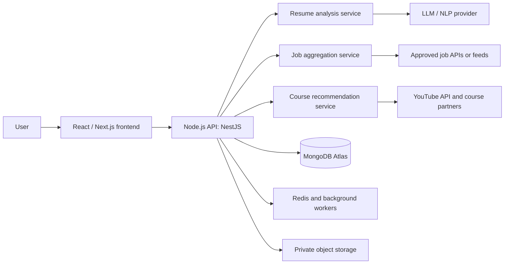

# Resume Intelligence Platform — Detailed Project Plan

## 1. Project Summary

Build a web application where users upload a resume and receive:

1. An explainable ATS-readiness score out of 100.
2. Specific, actionable resume improvements to maximise that score.
3. Job recommendations that match skills, experience, role preferences, and location.
4. Course recommendations that address skill gaps found from the resume and job-market demand.

Use React/TypeScript, Node.js/TypeScript, and MongoDB. The system must be privacy-conscious, technically reliable, and realistic about third-party platform access.

> Important: there is no universal ATS score. Different applicant tracking systems use different parsers and ranking approaches. Present the result as an ATS-readiness score, show its breakdown, and allow scoring against a selected job description.

## 2. Objectives and Scope

### Primary objectives

- Accept PDF and DOCX resumes.
- Extract and structure resume information accurately.
- Calculate an explainable ATS-readiness score from 0–100.
- Identify formatting, content, keyword, and experience-quality improvements.
- Match users with relevant jobs and explain the match.
- Recommend learning resources for missing, high-demand skills.
- Provide sorting, filtering, pagination, privacy controls, and a responsive dashboard.

### Out of scope for the first release

- Automatically applying to jobs for users.
- Promising a job or interview outcome.
- Inventing skills, work experience, qualifications, or achievements.
- Unapproved scraping of job boards or course platforms.

## 3. Recommended Technology Stack

| Layer | Recommended technology | Reason |
|---|---|---|
| Frontend | Next.js (React), TypeScript, Tailwind CSS | Fast, responsive, SEO-friendly, maintainable |
| Backend API | NestJS, TypeScript | Modular design, validation, testing, clear API structure |
| Database | MongoDB Atlas | Flexible document model for resumes, jobs, and recommendations |
| Search | MongoDB Atlas Search + Vector Search | Keyword and semantic matching |
| Background processing | Redis + BullMQ | Reliable resume analysis and source refreshes |
| File storage | AWS S3 or Cloudflare R2 | Secure private resume storage |
| Resume extraction | pdf-parse/Apache Tika; Mammoth for DOCX | Extract resume text |
| AI/NLP | LLM API + deterministic rules | Helpful suggestions with auditable scores |
| Authentication | Clerk/Auth0 or JWT with refresh tokens | Secure accounts |
| Deployment | Vercel, Render/AWS, MongoDB Atlas | Simple deployment and scaling |
| Monitoring | Sentry + structured logs | Error detection and debugging |

## 4. High-Level Architecture



- Background workers keep the UI fast during longer analysis.
- Job integrations are isolated behind source adapters.
- Resume files are private and separate from application data.
- Scoring rules remain testable instead of relying only on an LLM.

## 5. Core User Journey

1. User creates an account and uploads a PDF or DOCX resume.
2. Backend validates, virus-scans, and stores the file privately.
3. A worker extracts text and builds a structured candidate profile.
4. ATS-readiness service creates a score and improvements.
5. Job service uses skills, role, seniority, location, and preferences to rank jobs.
6. Course service identifies skill gaps and recommends relevant courses.
7. User reviews suggestions, saves jobs/courses, and tracks applications.

## 6. Module A — Resume Upload and Parsing

### File rules

- Support PDF (.pdf) and Word (.docx).
- Limit size to 5–10 MB.
- Validate MIME type and file signature, not extension alone.
- Reject corrupted/password-protected files clearly.
- Malware-scan every upload.
- Use a private storage key; do not expose original filename publicly.

### Extracted information

- Contact information
- Professional summary
- Education
- Work experience
- Projects
- Technical and soft skills
- Certifications and achievements
- Languages
- Links such as LinkedIn, GitHub, and portfolio

Example parsed profile:

```ts
CandidateProfile {
  name?: string;
  email?: string;
  phone?: string;
  location?: string;
  summary?: string;
  skills: string[];
  experience: Experience[];
  education: Education[];
  projects: Project[];
  certifications: Certification[];
  links: { label: string; url: string }[];
}
```

Show the extracted profile for user corrections before generating final recommendations.

## 7. Module B — ATS-Readiness Score

### Score rubric

| Category | Points | Checks |
|---|---:|---|
| Parsing and formatting | 20 | Selectable text, readable layout, standard headings, one-column compatibility |
| Required sections | 15 | Contact, summary, education, experience, skills, projects where appropriate |
| Skills and keywords | 25 | Role-relevant skills and job-description coverage |
| Experience quality | 15 | Action verbs, dates, clear titles/companies, quantified impact |
| Content quality | 10 | Grammar, repetition, vague wording, unnecessary personal information |
| ATS compatibility | 10 | Avoid key content in tables, columns, graphics, headers, footers |
| Target job alignment | 5 | Semantic/keyword alignment with a chosen job description |

### Hybrid method

1. Deterministic rules: section presence, email/phone format, headings, dates, action verbs, word counts, text density, tables, columns, and keyword coverage.
2. NLP/LLM analysis: concise rewrites, semantic matching, skill extraction, grammar assistance, and unclear phrasing.

Every deduction must display the affected section, reason, score impact, and exact repair action.

Example:

> Score: 72/100  
> Add measurable outcomes to four experience bullets: potential +8.  
> Replace two-column formatting with a one-column layout: potential +6.  
> Add accurate evidence of SQL, Power BI, Excel, and dashboarding for Data Analyst roles: potential +7.

Never suggest adding a skill or achievement unless it is true and the candidate can support it in an interview.

## 8. Module C — Resume Improvement Assistant

| Priority | Examples |
|---|---|
| Critical | Unreadable file, missing contact details, non-standard layout, missing dates |
| High impact | Missing role keywords, no quantified achievements, weak experience bullets |
| Polish | Grammar, repetition, concise wording, stronger action verbs |

Features:

- Original versus suggested version for every bullet.
- Accept, reject, or edit workflow.
- Recalculate after accepted changes.
- Paste a job description to tailor the resume.
- Resume-version history and score history.
- Future enhancement: export improved DOCX/PDF.

Example:

```text
Original: Worked on the company website.
Improved: Built and maintained responsive React features for the company website,
improving page-load performance by 22%.
```

The user must verify factual accuracy.

## 9. Module D — Job Discovery and Matching

### Legal data-source strategy

Do not scrape LinkedIn, Indeed, Glassdoor, Naukri, Internshala, or similar sites without explicit approval. Use this order:

1. Official job-board partner APIs or written partnerships.
2. Licensed job-aggregation providers.
3. Employer career-page feeds and applicant-tracking-system feeds.
4. Deep links to source pages where data display/reuse is not permitted.

Job-source integration is a legal/business workstream, not only a coding task.

### Source adapter

```ts
interface JobSourceAdapter {
  sourceName: string;
  search(query: JobSearchQuery): Promise<ExternalJob[]>;
  normalize(job: ExternalJob): NormalizedJob;
  healthCheck(): Promise<SourceHealth>;
}
```

### Normalized job document

```ts
Job {
  source: "linkedin" | "indeed" | "naukri" | "glassdoor" | "internshala" | "other";
  externalJobId: string;
  title: string;
  company: string;
  location: string;
  workMode: "remote" | "hybrid" | "onsite";
  employmentType: string;
  salaryMin?: number;
  salaryMax?: number;
  currency?: string;
  skills: string[];
  description: string;
  postedAt: Date;
  applicationUrl: string;
  sourceUrl: string;
  matchScore: number;
  matchReasons: string[];
}
```

### Job-match formula

| Factor | Weight |
|---|---:|
| Skills overlap | 35% |
| Resume/job-description semantic similarity | 25% |
| Experience-level match | 15% |
| Location/work-mode match | 10% |
| Role/title similarity | 10% |
| Recency | 5% |

Example explanation:

> 86% match  
> Matches: React, TypeScript, REST APIs, and 2–4 years experience.  
> Missing or weak evidence: Docker, AWS, and CI/CD.

### Filters, sorting, and pagination

- Default sort: latest job posting first.
- Sort by latest, highest salary, company name, or location.
- Filter by location, salary range, work mode, employment type, source, role, and experience.
- Exactly 10 jobs per page.
- Limit a result set to 100 jobs.
- Deduplicate jobs across sources.
- Show source attribution and outbound application link.
- Refresh data using scheduled workers, not on every page load.

Example endpoints:

```http
GET /api/jobs?resumeId=...&page=1&limit=10&sort=latest
GET /api/jobs?resumeId=...&page=1&limit=10&sort=salary_desc
GET /api/jobs?resumeId=...&page=1&limit=10&sort=company_asc
GET /api/jobs?resumeId=...&page=1&limit=10&location=Bengaluru
```

## 10. Module E — Course Recommendations

### Skill-gap workflow

1. Identify skills in the resume.
2. Identify skills repeatedly required by best-matching jobs.
3. Find high-priority missing skills.
4. Recommend learning resources for each gap.

Example:

```text
Target role: Frontend Developer
Current strengths: React, JavaScript, HTML, CSS
High-demand gaps: TypeScript, Next.js, testing, Git, Docker
```

### Course sources

- YouTube Data API.
- Coursera partner/catalog access where available.
- Udemy affiliate, business, or partner access where available.
- Other providers with licensed/approved catalog data.

### Course-ranking formula

| Factor | Weight |
|---|---:|
| Match to high-priority skill gap | 35% |
| Rating and review volume | 25% |
| Freshness / last update | 15% |
| Price and value | 15% |
| Provider credibility / completion indicators | 10% |

Show title, provider, instructor, skills addressed, price, rating, review count, update date, duration, level, provider link, and a personalised explanation.

Example:

> TypeScript for React Developers — Udemy  
> Why recommended: TypeScript appears in many of your highest-matching frontend roles but is absent from your resume. This course directly fills that gap and improves eligibility for React/Next.js positions.

## 11. MongoDB Data Model

Collections:

```text
users
resumes
resumeVersions
resumeAnalyses
jobSearchPreferences
jobs
jobMatches
courses
courseRecommendations
applications
feedback
auditLogs
```

| Collection | Purpose |
|---|---|
| users | Accounts, profiles, consent, roles, settings |
| resumes | File metadata, storage key, parsed profile, processing status |
| resumeVersions | Edit and re-analysis history |
| resumeAnalyses | Score, deductions, suggestions, skills |
| jobs | Normalized approved-source job records |
| jobMatches | User/job score, reasons, saved/applied state |
| courses | Normalized course metadata |
| courseRecommendations | Personal ranking and explanation |
| applications | Application tracker |
| auditLogs | Security and administrative audit trail |

Important indexes:

```text
jobs: { postedAt: -1 }
jobs: { source: 1, externalJobId: 1 } unique
jobs: Atlas Search/vector index for title, description, skills
jobMatches: { userId: 1, matchScore: -1 }
courseRecommendations: { userId: 1, rankingScore: -1 }
resumes: { userId: 1, createdAt: -1 }
```

## 12. Main Screens

1. Landing page
2. Registration/login
3. Resume upload
4. Resume analysis dashboard
5. ATS-readiness score breakdown
6. Resume suggestions with before/after edits
7. Job recommendations with filters, sorting, pagination
8. Job detail with matching explanation
9. Course recommendations
10. User profile and job preferences
11. Application tracker
12. Admin dashboard for source health, quota, failed imports, and moderation

## 13. API Design

```http
POST   /api/auth/register
POST   /api/auth/login

POST   /api/resumes/upload
GET    /api/resumes
GET    /api/resumes/:id
PATCH  /api/resumes/:id
DELETE /api/resumes/:id
POST   /api/resumes/:id/analyse
GET    /api/resumes/:id/analysis

POST   /api/jobs/search
GET    /api/jobs
GET    /api/jobs/:id
POST   /api/jobs/:id/save
POST   /api/jobs/:id/application

GET    /api/courses/recommendations?resumeId=...
POST   /api/courses/:id/save

GET    /api/applications
PATCH  /api/applications/:id
```

Use validation DTOs, authentication, authorization, rate limits, and consistent error responses for all endpoints.

## 14. Privacy, Security, and Ethics

- Obtain explicit consent before processing resumes.
- Use HTTPS and encryption at rest.
- Store resumes privately and use signed, time-limited download URLs.
- Redact contact details before sending content to AI providers where possible.
- Offer data export and permanent deletion.
- Define retention periods for files, parsed data, logs, and recommendations.
- Use input validation, rate limits, malware scanning, secret management, audit logs, and role-based access.
- Do not infer/use protected traits such as religion, caste, health, gender, age, or marital status.
- Clearly explain that recommendations are advisory and can be inaccurate.

## 15. Development Plan

### Phase 1 — Planning and foundation (1–2 weeks)

- Finalise requirements, user stories, acceptance criteria, wireframes, and schema.
- Set up repository, Next.js, NestJS, MongoDB Atlas, linting, testing, CI/CD.
- Implement authentication and secure upload.

### Phase 2 — Resume-analysis MVP (2–3 weeks)

- Build PDF/DOCX extraction and structured parser.
- Build deterministic score engine.
- Add guarded LLM suggestions.
- Create score/suggestion interface.
- Test with anonymised, diverse sample resumes.

### Phase 3 — Job-matching MVP (2–3 weeks)

- Build source-adapter layer.
- Integrate one approved source/feed first.
- Normalize, deduplicate, search, rank, filter, sort, paginate.
- Add match explanations and saved jobs.

### Phase 4 — Course recommendations (1–2 weeks)

- Build skill-gap engine.
- Integrate YouTube first.
- Add one approved paid-course source.
- Implement ranking, saving, and explanation.

### Phase 5 — Final quality and guide review (2 weeks)

- Security, privacy, load, accessibility, and usability tests.
- Implement guide feedback.
- Deploy stable demonstration.
- Prepare report, evidence, and demo video.

## 16. Testing Strategy

### Automated testing

- Unit tests: parser functions, scoring rules, match calculations, validation.
- Integration tests: upload → analysis → jobs → courses.
- API tests: authorization, invalid files, pagination, sorting, filtering.
- End-to-end tests: Playwright or Cypress journeys.

### Quality checks

- Test one-column, two-column, PDF, DOCX, and image-based resumes.
- Test score stability across repeated analyses.
- Test malformed/malicious uploads.
- Test duplicate jobs.
- Test mobile, desktop, keyboard navigation, and screen-reader behaviour.

### Evaluation metrics

| Metric | Why it matters |
|---|---|
| Resume extraction success rate | Parser reliability |
| Score consistency | Stability and explainability |
| Precision@10 for job matches | Quality of first 10 recommendations |
| Suggestion acceptance rate | User usefulness |
| Duplicate-job rate | Aggregation quality |
| API response time | UX and scalability |
| Course click/save rate | Recommendation value |
| Accessibility score | Inclusive quality |

## 17. Risks and Mitigations

| Risk | Mitigation |
|---|---|
| Job-board access restrictions | Use approved partners, licensed aggregators, feeds, and deep links |
| Incorrect AI suggestions | Combine rules and LLMs; require user verification; never invent facts |
| Poor PDF extraction | Support DOCX, show parsed profile, detect low-confidence extraction |
| Personal-data exposure | Private storage, encryption, redaction, consent, deletion |
| Duplicate/stale jobs | Normalize, deduplicate, refresh and expire records |
| API quota/cost overruns | Queue, cache, monitor quotas, rate-limit |
| Biased matching | Exclude protected traits and audit scoring inputs |

## 18. Guide Review Deliverables

- Problem statement, objectives, scope, limitations
- Functional and non-functional requirements
- Use-case diagram
- System architecture diagram
- MongoDB schema/ER-style diagram
- UI wireframes and screenshots
- API specification
- ATS scoring rubric and sample calculations
- Job-matching algorithm, weights, and evaluation method
- Security and privacy design
- Testing plan and evidence
- Weekly progress report and risk log
- Final deployment, source repository, presentation, and demo video

## 19. Recommended MVP Scope

For the first end-to-end demonstration, implement:

1. Authentication.
2. PDF/DOCX upload and structured parsing.
3. Explainable ATS-readiness score and fixes.
4. Paste-a-job-description tailoring.
5. One approved job feed with 10 jobs/page and a maximum of 100 results.
6. YouTube course recommendations based on skill gaps.
7. Privacy controls, deletion, logging, and core tests.

Add further job boards and paid-course sources only after approved access or partnership.

## 20. Reference Notes

- LinkedIn crawling terms: https://www.linkedin.com/legal/crawling-terms
- Indeed developer agreement: https://docs.indeed.com/legal-terms/developer-agreement
- Glassdoor terms: https://www.glassdoor.com/about/terms-2020-07-08/
- LinkedIn Job Posting API overview: https://learn.microsoft.com/en-us/linkedin/talent/job-postings/api/overview?view=li-lts-2025-01
- YouTube Data API Search: https://developers.google.com/youtube/v3/docs/search/list

